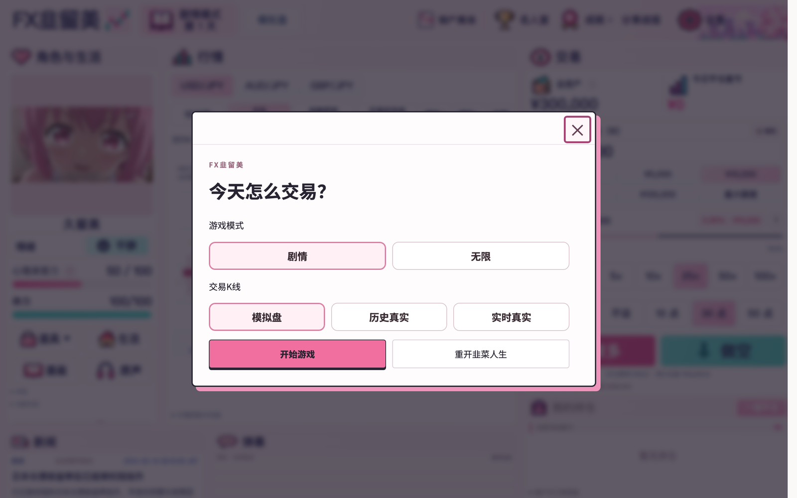

# 久留美 · FX 静态运行版

独立游戏的已验证静态运行产物，只保留可公开的运行文件，不含私有测试与剧情评审素材。

<p align="center">
  
</p>

**在线访问：** <https://gongfpp.github.io/kurumi-fx-pages/>


## 说明

- 本仓库为可公开的静态运行/构建产物，不包含私有源码、测试与评审素材。
- 仓库未附开源许可，代码、文案与素材未授予额外复用许可；第三方引擎与字体按其自带许可使用。

## 本地运行

静态站点，任意静态服务器即可：

```bash
python3 -m http.server 8080
# 浏览器打开 http://localhost:8080/
```
